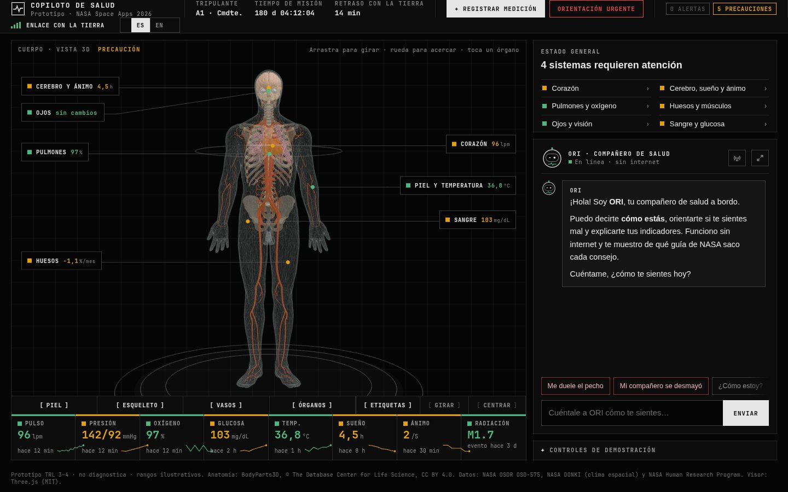

<div align="center">
  <a href="https://www.spaceappschallenge.org/2026/">
    
  </a>
</div>

<div align="center">

# ORI · Copiloto de salud

**Cuando la Tierra está lejos, el apoyo debe estar a bordo.**

NASA Space Apps Challenge 2026 · Moquegua, Perú<br>
[English](README.md) · **Español**

[El desafío](https://www.spaceappschallenge.org/2026/challenges/health-monitoring-software/) · [Inicio rápido](#inicio-rápido) · [IA local](IA_LOCAL.md)

</div>



## De las mediciones al siguiente paso

Los astronautas ya se entrenan y monitorean su salud. Las misiones largas añaden demoras e interrupciones en el apoyo médico desde Tierra. **ORI reúne registros, tendencias y orientación en un asistente visual local**, para ayudar a la tripulación a comprender cambios y explorar sus siguientes pasos.

| Monitorear | Comprender | Dar seguimiento |
| --- | --- | --- |
| Registrar indicadores y su contexto en SQLite. | Explorar el cuerpo 3D, las tendencias y las explicaciones con fuentes. | Consultar guías a bordo y conservar los registros, incluso sin enlace con Tierra. |

<table>
<tr>
<td width="50%"><br><b>Tu cuerpo, en contexto</b> · Selecciona órganos, consulta mediciones y revisa tendencias.</td>
<td width="50%"><br><b>ORI, a bordo</b> · Pregunta sobre tus registros y consulta la guía detrás de la respuesta.</td>
</tr>
</table>

**Incluye:** español / inglés · capas anatómicas · historial local · reglas ilustrativas · instrucciones de medición · orientación urgente educativa · eventos de clima espacial guardados. El enlace con Tierra y el envío de resúmenes son simulados.

## Inicio rápido

Requiere Python 3.10+, [uv](https://docs.astral.sh/uv/) y un navegador con WebGL.

```bash
git clone https://github.com/JoosX/HackatonNasa.git
cd HackatonNasa
uv run --with fastapi --with uvicorn uvicorn backend.main:app --host 127.0.0.1 --port 8000
```

Abre **http://127.0.0.1:8000**. Cambia el idioma con **ES | EN**.

Para conversar con el modelo local, instala e inicia [Ollama](https://ollama.com/download) y descarga:

```bash
ollama pull gemma3:4b
ollama pull nomic-embed-text
```

Después de la instalación, la aplicación y los modelos funcionan localmente. Sin Ollama, ORI utiliza guías y respuestas predefinidas. Las descargas iniciales y las actualizaciones externas requieren conexión.

<details>
<summary><b>Arquitectura y comprobaciones técnicas</b></summary>

Navegador / Three.js → FastAPI → SQLite + reglas + consulta de guías locales / Ollama.

```bash
uv run --with pytest --with fastapi --with httpx python -m pytest -q tests
node --test tests/emergencia.test.mjs tests/orientacion.test.mjs
```

Consulta la [configuración de IA](IA_LOCAL.md), los [créditos del modelo](frontend/modelos/LEEME.md) y la [revisión pendiente de las guías](docs/validacion-orientacion.md).

</details>

## Recursos NASA

- **[Peligros HRP](https://www.nasa.gov/hrp/hazards/) / [Riesgos](https://www.nasa.gov/hrp/risks/):** contexto científico para las guías educativas.
- **[OSDR OSD-575](https://osdr.nasa.gov/bio/repo/data/studies/OSD-575):** ejemplos históricos de laboratorio de Inspiration4; no son datos en vivo.
- **[DONKI](https://ccmc.gsfc.nasa.gov/tools/DONKI/):** eventos de clima espacial guardados; no mide la dosis personal de radiación.

## Alcance del prototipo

**Prototipo educativo, sin diagnóstico, prescripción ni aprobación clínica.** Las mediciones de demostración son ficticias; los datos históricos NASA se identifican por separado. Las reglas y guías requieren revisión profesional. La IA y sus citas pueden equivocarse. Un indicador verde no descarta una urgencia. Utiliza datos ficticios: no están implementadas las protecciones de privacidad y acceso de un producto final.

---

**Créditos:** BodyParts3D © The Database Center for Life Science, [CC BY 4.0](https://dbarchive.biosciencedbc.jp/en/bodyparts3d/lic.html) · Three.js (MIT) · JetBrains Mono (OFL). Capturas del repositorio. Logo del evento proporcionado por el equipo, presentado sobre fondo oscuro. [Identidad de Space Apps](https://www.spaceappschallenge.org/brand/).

**Uso de IA:** el código, los textos y las traducciones del proyecto incluyen asistencia de Claude; este README se preparó con asistencia de OpenAI Codex. La participación y las referencias a NASA no implican su respaldo.
