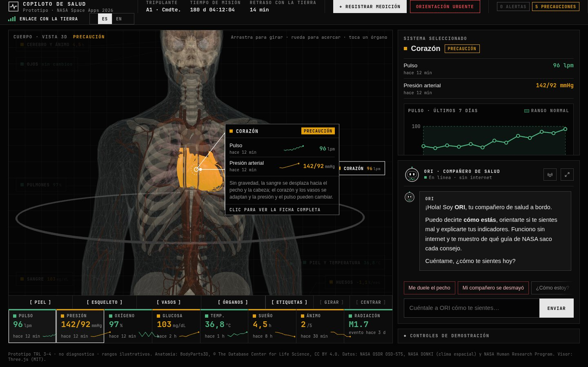
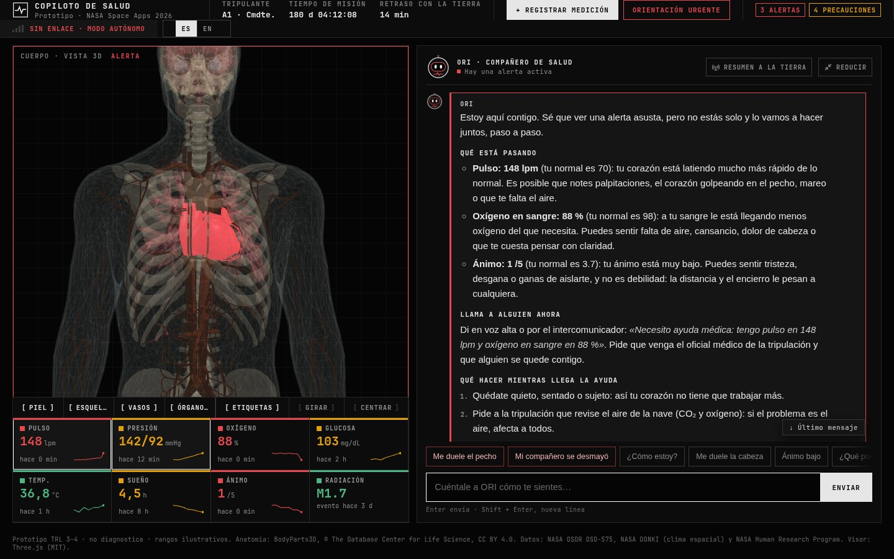
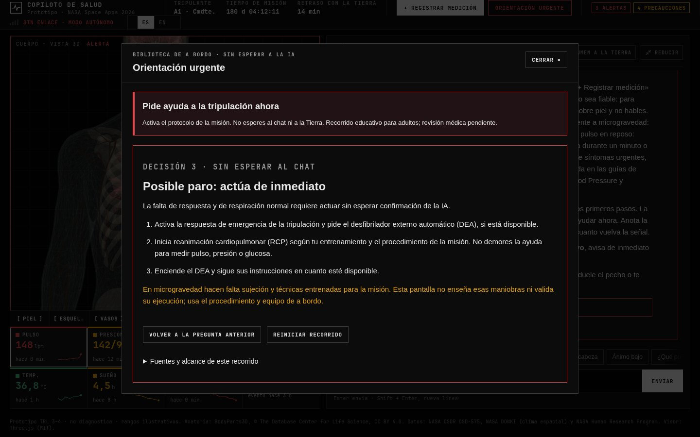
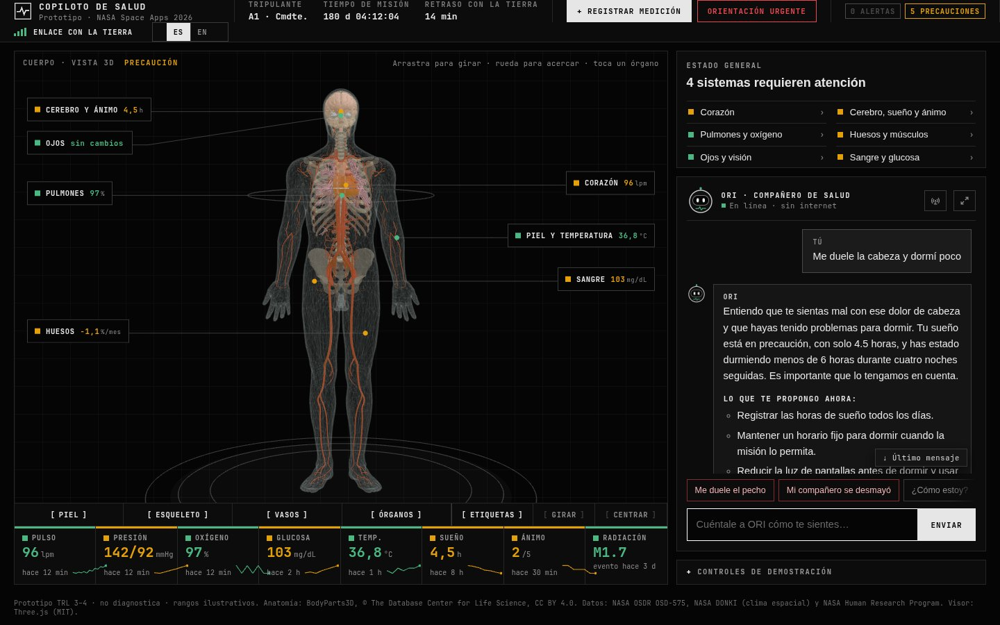
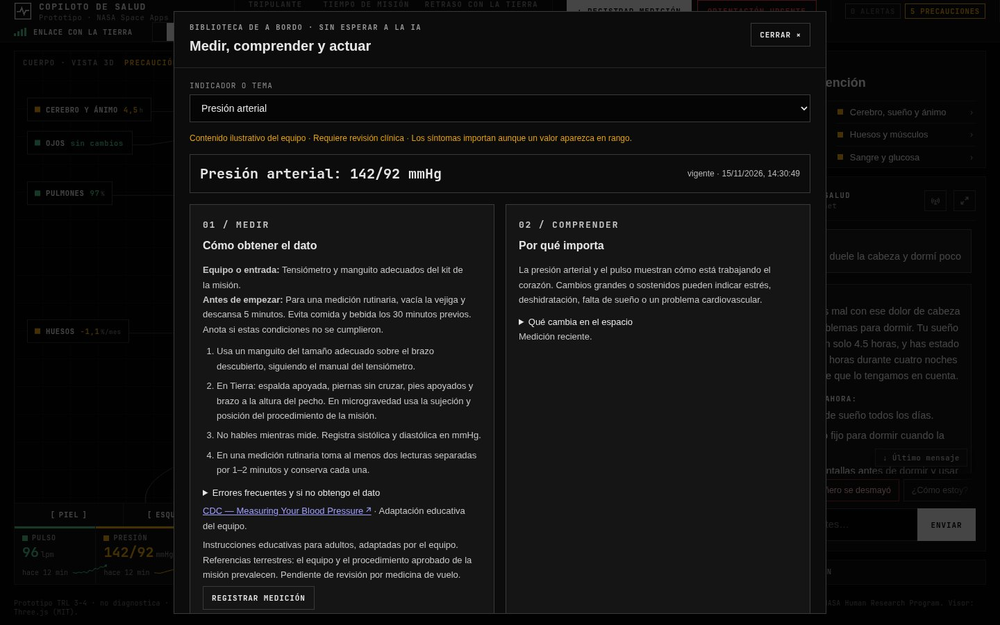

[English](README.md) | **Español**

# Copiloto de salud · prototipo (NASA Space Apps 2026)

Asistente de salud **local** para astronautas, con **ORI**, un compañero de salud con IA: monitoreo con semáforo, cuerpo 3D anatómico y asistente con IA que responde **sin conexión con la Tierra**, citando la guía de la que sale cada consejo. Prototipo TRL 3–4; **no diagnostica ni receta**.

Reto: *Create Health Monitoring Software for Astronauts on Space Missions*.


## La problemática

> ¿Cómo podríamos permitir que una tripulación con conocimientos médicos parciales sepa qué está pasando con su salud y cómo actuar, aun sin conexión con la Tierra?

En la Estación Espacial, los médicos de vuelo en la Tierra responden casi en tiempo real. Rumbo a Marte ese modelo deja de funcionar: un mensaje tarda **de 3 a 22 minutos solo de ida** (hasta ~44 minutos ida y vuelta), y cada ~2 años una conjunción solar corta la comunicación durante **unas dos semanas**. Incluso alrededor de la Luna, Artemis II estuvo **unos 40 minutos** sin contacto detrás de ella. Los astronautas no son médicos y una emergencia no puede esperar.

**Qué hace la app:** registra los signos vitales, los compara con el normal de cada persona, los muestra como un semáforo en un cuerpo 3D y, con ORI, explica en palabras simples qué está pasando, qué hacer y a quién avisar, todo dentro de la nave. Cuando vuelve el enlace, el resumen se envía a los médicos en la Tierra, que son quienes deciden cualquier tratamiento.

## Capturas

<table>
<tr><td width="50%" valign="top"><br><b>Ficha de un órgano</b><br>Al pasar el mouse sobre un órgano se ven sus valores y tendencia; la ficha agrega la gráfica de 7 días con la banda normal.</td><td width="50%" valign="top"><br><b>Emergencia sin enlace con la Tierra</b><br>Con una alerta y sin señal, ORI explica qué pasa, qué puedes sentir, a quién llamar y qué hacer.</td></tr>
<tr><td width="50%" valign="top"><br><b>Recorrido de emergencia paso a paso</b><br>¿Responde? ¿Respira? Botones grandes que llevan a la RCP y al desfibrilador; funciona aunque falle todo lo demás.</td><td width="50%" valign="top"><br><b>ORI con la IA local</b><br>Empatía y explicación de tus propios datos, más pasos copiados de la guía, sin internet.</td></tr>
<tr><td width="50%" valign="top"><br><b>Medir, comprender y actuar</b><br>Cómo tomar cada medida, por qué importa y cuándo avisar, con sus fuentes.</td><td width="50%" valign="top"><br><b>Vista general</b><br>Cuerpo 3D con los colores del panel de alarmas de una nave, tira de signos vitales y estado general.</td></tr>
</table>

## Ejecutar

Requisitos: Python 3, [uv](https://docs.astral.sh/uv/) (o `pip install -r requirements.txt`) y, para la IA, Ollama con `gemma3:4b` y `nomic-embed-text` (ver `IA_LOCAL.md`).

Desde la raíz del repositorio:

```bash
uv run --with fastapi --with uvicorn uvicorn backend.main:app --port 8000
```

Abrir http://localhost:8000 en Chrome o Chromium (el visor 3D necesita WebGL). La app se abre **en inglés por defecto**; con `?lang=es` (o el botón **ES | EN**) se cambia a español.

Atajos para la demo: `?organo=corazon` abre un órgano (la cámara lo enfoca) · `#emergencia` simula una emergencia · `#sinsenal` empieza sin conexión · `#hover-corazon` muestra la tarjeta de hover (capturas) · `#preguntar=texto` le hace esa pregunta a ORI al cargar · `?quieto` detiene el giro.

El modelo de IA (Gemma 3 4B, ~3,4 GB) no está en el repositorio: se descarga con `ollama pull gemma3:4b` y `ollama pull nomic-embed-text`. Los índices de búsqueda de las guías (`data/indice_guias.json`, `data/indice_guias_en.json`) sí están incluidos.

## Idiomas

La app funciona en **español e inglés** (botón **ES | EN** arriba a la derecha). Por defecto está en inglés; la elección se recuerda en el navegador.

- Interfaz: `frontend/js/i18n.js` (`L("español", "English")` en todos los módulos).
- Servidor: `backend/idioma.py` lee la cookie `idioma` (o `?lang=`) en cada petición; ORI, reglas, fichas, el motor de reglas, el clima espacial y los protocolos de emergencia responden en ese idioma. ORI reconoce frases en los dos idiomas.
- Contenido en inglés: `data/guias_en/` (11 guías con la misma estructura que las de español), `data/en/` (fichas, reglas, guías de medición) y su propio índice (`python scripts/indexar_guias.py` genera los dos).

## Base de datos de a bordo (SQLite)

Las mediciones se guardan en `data/mision.db` (un solo archivo, sin servidor, funciona sin internet). Al primer arranque se siembra un historial de demostración de 7 días; luego se suman las mediciones nuevas. `backend/motor.py` calcula con `data/reglas.json` el color, la tendencia, **tu normal** (promedio de tus primeras mediciones) y la calidad del dato (vigente, sospechoso, vencido o con contexto pendiente; por ejemplo, la glucosa medida después de comer no se clasifica).

- Registrar: botón **+ Registrar medición** (o `POST /api/mediciones`), con el contexto de la medición (en reposo, en ayunas…). ORI comenta cada medición.
- Sensor simulado: `python scripts/sensor_simulado.py` (o `--subida` para que el pulso llegue a alerta en la demo). La app se actualiza sola cada 15 s.
- Reiniciar la demo: "Controles de demostración → Reiniciar datos" (o `POST /api/demo/reiniciar`).
- ORI recuerda los últimos turnos de la conversación: entiende "¿y por qué pasa eso?".

## Emergencias y orientación

- **ORI en una emergencia** (`backend/emergencia.py`): ante "me duele el pecho", "mi compañero se desmayó" o un indicador en alerta con "¿qué hago?", responde al instante y sin IA: qué puede estar pasando, qué se siente, a quién llamar y qué decirle, pasos con su porqué y qué hacer sin enlace con la Tierra. El chat se amplía solo.
- **Orientación urgente** (botón rojo arriba, aporte de Romario): recorrido paso a paso, "¿responde?" y luego "¿respira?", hasta la RCP y el desfibrilador. Funciona aunque fallen el servidor, la IA o el enlace.
- **Medir, comprender y actuar** (aporte de Romario): por indicador, equipo, preparación, pasos, errores frecuentes y qué hacer sin equipo, con fuentes (MedlinePlus, CDC, FDA). Se abre con «¿Cómo tomo esta medida?» al registrar.
- Alcance y validación pendiente: [`docs/validacion-orientacion.md`](docs/validacion-orientacion.md). Nada de esto tiene aprobación clínica.

## Cómo se evita que la IA se equivoque

- La IA solo escribe la parte humana (empatía y explicación). **Los pasos y el "cuándo avisar" se copian tal cual de las guías**, así que no se pueden inventar, y cada respuesta muestra su fuente.
- **Las emergencias no usan IA**: protocolos fijos e instantáneos que siempre responden igual.
- Si no hay una guía relevante, ORI lo dice en vez de inventar; si una pregunta no tiene datos relacionados, se le indica a la IA que no mencione cifras.
- Un dato dudoso (imposible, antiguo o sin contexto) nunca se presenta como normal.

## Clima espacial (NASA DONKI)

`data/nasa_donki.json` guarda los eventos solares reales de los últimos 30 días (llamaradas, partículas solares y tormentas geomagnéticas) de NASA DONKI. Es la "sincronización con la Tierra": se actualiza con `python scripts/actualizar_donki.py` cuando hay señal, y sin señal la app usa el último archivo y avisa su antigüedad. El nivel de radiación (verde, precaución o alerta) se calcula en `backend/clima_espacial.py` con reglas ilustrativas. Desde el 30/09/2026 el servicio está en `https://ccmc.gsfc.nasa.gov/DONKI-API/get/` (sin clave).

## Pruebas

```bash
uv run --with pytest --with fastapi --with httpx python -m pytest -q tests
node --test tests/*.mjs
```

146 pruebas en Python (guías, semáforo, fichas, datos NASA, modelo 3D, base de datos, contexto y calidad del dato, protocolos de emergencia, orientación, los dos idiomas, asistente con y sin IA, API) y 11 en JavaScript (recorrido de emergencia y orientación).

## Estructura y dueños

| Carpeta / archivo | Qué es | Dueño |
|---|---|---|
| `frontend/index.html`, `css/app.css`, `js/app.js` | App principal: visor, signos, ficha, chat, enlace con la Tierra | P2 / P3 |
| `frontend/js/visor3d.js`, `modelos/cuerpo.glb` | Visor 3D y modelo anatómico | P3 / P5 |
| `frontend/js/chat.js` | Chat con el asistente | P3 |
| `frontend/js/i18n.js`, `backend/idioma.py` | Idiomas (español / inglés) | P5 |
| `backend/main.py` | API (FastAPI) y servidor del frontend | P4 |
| `backend/db.py`, `backend/motor.py` | Base de datos de a bordo y motor de reglas | P4 |
| `backend/rag.py`, `ollama_cliente.py`, `guias.py` | Asistente RAG local | P5 |
| `backend/emergencia.py` | Protocolos de emergencia de ORI | P5 |
| `data/guias/*.md`, `data/guias_en/*.md`, `reglas.json`, `fichas.json`, `nasa_osd575.json` | Contenido y datos NASA | P6 |
| `backend/orientacion.py`, `data/medicion_guiada.json`, `frontend/js/orientacion*.js`, `emergencia.js`, `docs/validacion-orientacion.md` | Orientación urgente y guías de medición | Romario |
| `scripts/` | Indexar guías, convertir OSD-575, sincronizar DONKI, sensor simulado, construir el modelo en Blender | P5 / P6 |
| `tests/` | Pruebas automáticas | P6 |

## Diseño

**Dirección de arte: pantalla de aviónica de tripulación.** Negro plano, aristas rectas y líneas de 1 px (sin brillos, desenfoques ni degradados), como los displays de cabina. El color solo transmite significado, según el sistema de Precaución y Alerta (C&W) de vuelo: verde = normal, ámbar = precaución, rojo = alerta; la selección es blanca y los rótulos, gris neutro. Datos en JetBrains Mono (OFL, incluida en `frontend/fuentes/`).

Se aplicaron las [Web Interface Guidelines de Vercel](https://github.com/vercel-labs/web-interface-guidelines) (accesibilidad, foco visible, `prefers-reduced-motion`, números tabulares, estados de carga, sin `transition: all`) y principios de [taste-skill](https://github.com/leonxlnx/taste-skill) (la interfaz real del producto como protagonista, un solo efecto visual, un sistema de tokens, micro-interacciones discretas). Se usaron como referencia; no se instalaron sus scripts.

## Créditos y licencias

- Anatomía: **BodyParts3D, © The Database Center for Life Science licensed under CC Attribution 4.0 International**.
- Datos: NASA OSDR **OSD-575** (Inspiration4), **NASA DONKI** (clima espacial, CCMC / NASA GSFC) y NASA Human Research Program. Referencias de técnica de medición: MedlinePlus, CDC, FDA; referencias de RCP: Resuscitation Council UK (2025), DGLRM / ESAM-SMG (2020).
- Visor: Three.js (MIT). Servidor: FastAPI (MIT). IA local: Ollama, Gemma 3 4B, nomic-embed-text.
- **Uso de IA:** el código, los textos y las traducciones se escribieron con asistencia de una herramienta de IA (Claude) y los revisó el equipo; los archivos lo indican en su encabezado. La idea, la definición del problema y las decisiones de diseño son del equipo. Es un prototipo: las guías se basan en información de NASA pero no son protocolos oficiales de NASA, y los rangos de color son ilustrativos, pendientes de revisión por medicina de vuelo.
