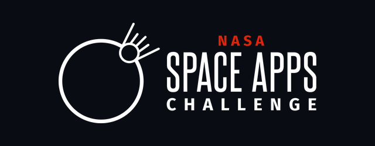

<div align="center">
  <a href="https://www.spaceappschallenge.org/2026/">
    
  </a>
</div>

<div align="center">

# ORI · Health Copilot

**When Earth is far away, support belongs on board.**

NASA Space Apps Challenge 2026 · Moquegua, Peru<br>
**English** · [Español](README.es.md)

[Challenge](https://www.spaceappschallenge.org/2026/challenges/health-monitoring-software/) · [Quick start](#quick-start) · [Local AI](IA_LOCAL.md)

</div>


## From measurements to a next step

Astronauts already train and monitor their health. Long missions add delayed or interrupted medical support from Earth. **ORI brings records, trends and guidance together in a local visual assistant**, helping the crew understand changes and explore their next steps.

| Monitor | Understand | Follow up |
| --- | --- | --- |
| Record indicators and measurement context in SQLite. | Explore the 3D body, trends and explanations with sources. | Consult onboard guidance and keep a local record, even without an Earth link. |

<table>
<tr>
<td width="50%"><br><b>Your body, in context</b> · Select organs, inspect measurements and review trends.</td>
<td width="50%"><br><b>ORI, on board</b> · Ask about your records and consult the guide behind the response.</td>
</tr>
</table>

**Built in:** English / Spanish · offline voice (talk to ORI, spoken answers and emergency alarms) · anatomical layers · local history · illustrative status rules · measurement instructions · educational urgent guidance · cached NASA space-weather events. The Earth-link and summary-delivery controls are simulated.

## Quick start

Requires Python 3.10+, [uv](https://docs.astral.sh/uv/) and a browser with WebGL.

```bash
git clone https://github.com/JoosX/HackatonNasa.git
cd HackatonNasa
uv run --with fastapi --with uvicorn uvicorn backend.main:app --host 127.0.0.1 --port 8000
```

Open **http://127.0.0.1:8000**. Use **ES | EN** to switch languages.

For model-generated conversation, install and start [Ollama](https://ollama.com/download), then download:

```bash
ollama pull gemma3:4b
ollama pull nomic-embed-text
```

**Optional offline voice:** download ORI's voices once (`python scripts/descargar_voces.py`, ~60 MB each) and start the server with `--with faster-whisper --with numpy --with piper-tts` (requires `ffmpeg`). The microphone is transcribed locally with Whisper and ORI speaks with Piper; audio never leaves the computer.

After setup, the app and models run locally. Without Ollama, ORI uses guide-based and predefined responses. Initial downloads and external dataset updates need connectivity.

<details>
<summary><b>Architecture and technical checks</b></summary>

Browser / Three.js → FastAPI → SQLite + rule engine + local guide retrieval / Ollama.

```bash
uv run --with pytest --with fastapi --with httpx python -m pytest -q tests
node --test tests/*.mjs
```

> **ORI is built around local AI.** On the spacecraft everything runs offline on the onboard computer with Ollama (Gemma 3). The optional Gemini engine exists only for the online demo, where no local model is available; the app shows which engine answered.

See [AI setup](IA_LOCAL.md), [model credits](frontend/modelos/LEEME.md) and [guidance review](docs/validacion-orientacion.md).

</details>

## NASA resources

- **[HRP Hazards](https://www.nasa.gov/hrp/hazards/) / [Risks](https://www.nasa.gov/hrp/risks/):** scientific context for educational guides.
- **[OSDR OSD-575](https://osdr.nasa.gov/bio/repo/data/studies/OSD-575):** historical Inspiration4 laboratory examples, not live crew data.
- **[DONKI](https://ccmc.gsfc.nasa.gov/tools/DONKI/):** cached space-weather events, not personal radiation-dose measurements.

## Prototype scope

**Educational prototype. No diagnosis, prescriptions or clinical approval.** Measurements in the demo are fictional; historical NASA datasets are identified separately. Status rules and guidance require professional review. AI and citations can be wrong. A green status does not rule out an emergency. Use fictional records only; production privacy and access controls are not implemented.

---

**Credits:** BodyParts3D © The Database Center for Life Science, [CC BY 4.0](https://dbarchive.biosciencedbc.jp/en/bodyparts3d/lic.html) · Three.js (MIT) · JetBrains Mono (OFL) · faster-whisper (MIT) · Piper (GPL-3.0) with voices es_MX-ald (Unlicense dataset) and en_US-lessac (Blizzard 2013 dataset, non-commercial research). Screenshots from this repository. Event logo supplied by the team, displayed on a dark background. [Space Apps branding](https://www.spaceappschallenge.org/brand/).

**AI disclosure:** project code, text and translations include Claude assistance; this README was prepared with OpenAI Codex assistance. NASA references and event participation do not imply NASA endorsement.
