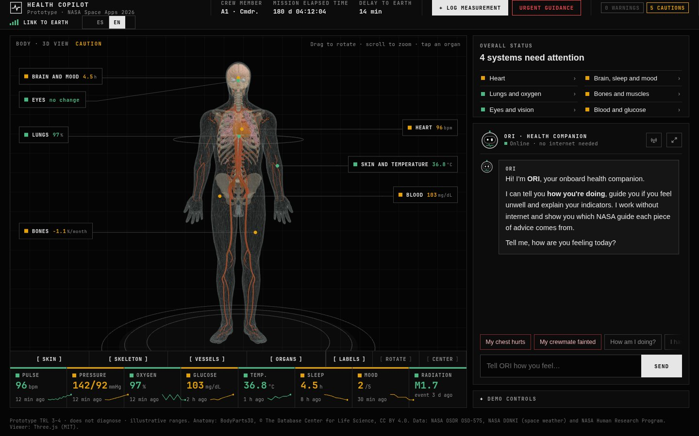
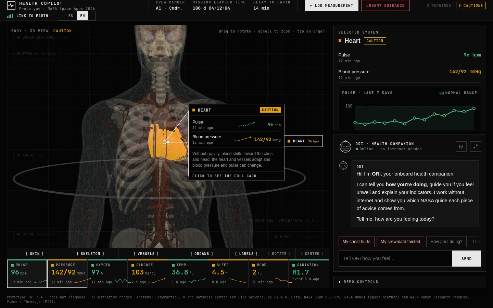
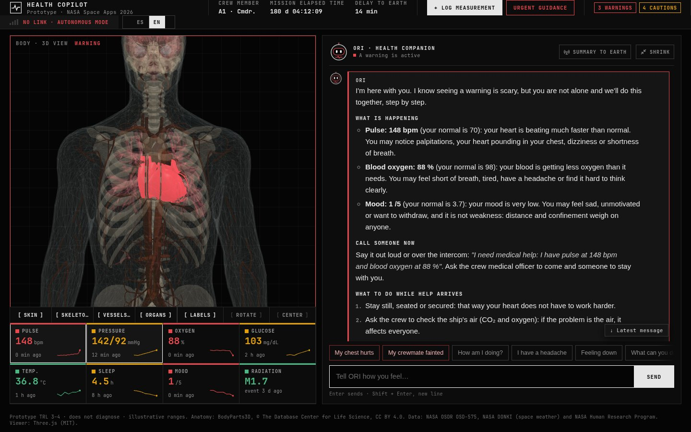
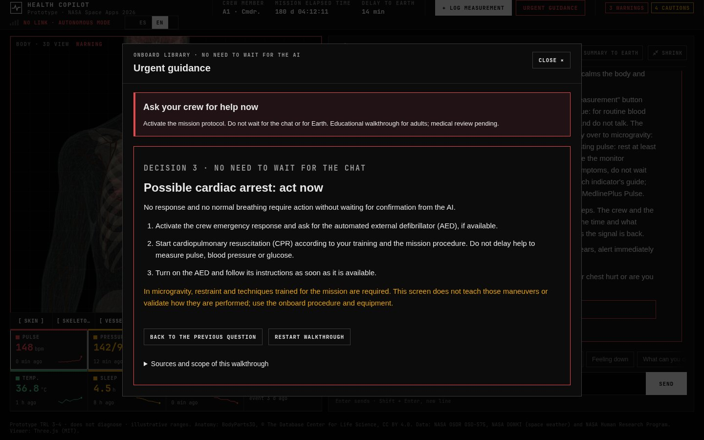
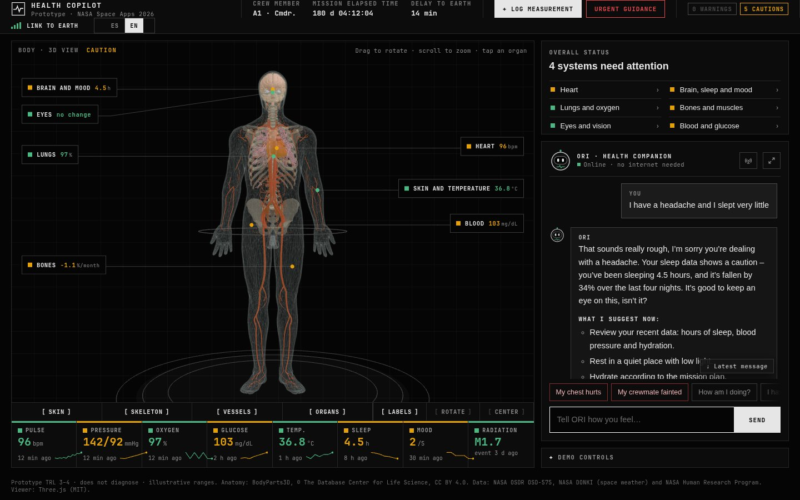
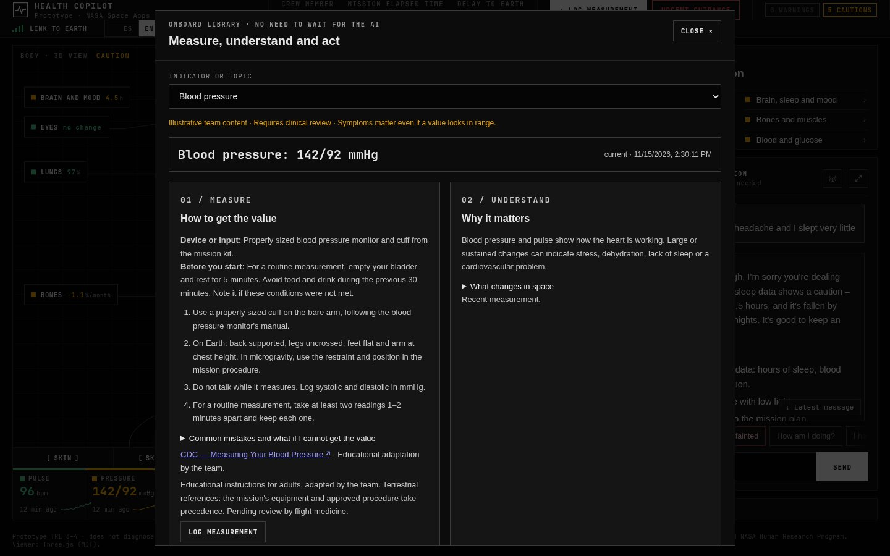

**English** | [Español](README.es.md)

# Health copilot · prototype (NASA Space Apps 2026)

A **local** health assistant for astronauts, featuring **ORI**, an AI health companion: traffic-light monitoring, an anatomical 3D body and an AI assistant that answers **with no connection to Earth**, citing the guide behind each piece of advice. Prototype at TRL 3–4; **it does not diagnose or prescribe**.

Challenge: *Create Health Monitoring Software for Astronauts on Space Missions*.



## The problem

> How might we help a crew with only partial medical knowledge understand what is happening with their health, and how to act, even without a connection to Earth?

On the Space Station, flight surgeons on Earth answer almost in real time. On the way to Mars that model breaks down: a message takes **3 to 22 minutes one way** (up to ~44 minutes round trip), and every ~2 years a solar conjunction blocks contact for about **two weeks**. Even around the Moon, Artemis II was out of contact for about **40 minutes** behind it. Astronauts are not doctors, and an emergency cannot wait.

**What the app does:** it records vital signs, compares them with each person's own normal, shows them as a traffic light on a 3D body and, through ORI, explains in plain language what is happening, what to do and whom to alert, entirely on board. When the link is back, the summary is sent to the doctors on Earth, who decide on any treatment.

## Screenshots

<table>
<tr><td width="50%" valign="top"><br><b>Organ card</b><br>Hovering an organ shows its values and trend; the card adds the 7-day chart with the normal range.</td><td width="50%" valign="top"><br><b>Emergency with no link to Earth</b><br>With a warning and no signal, ORI explains what is happening, what you may feel, whom to call and what to do.</td></tr>
<tr><td width="50%" valign="top"><br><b>Step-by-step emergency walkthrough</b><br>Responding? Breathing? Big buttons lead to CPR and the defibrillator; it works even if everything else fails.</td><td width="50%" valign="top"><br><b>ORI with the local AI</b><br>Empathy and an explanation of your own data, plus steps copied from the guide, with no internet.</td></tr>
<tr><td width="50%" valign="top"><br><b>Measure, understand and act</b><br>How to take each measurement, why it matters and when to alert, with its sources.</td><td width="50%" valign="top"><br><b>Overview</b><br>3D body colored like a ship's caution and warning panel, vital signs strip and overall status.</td></tr>
</table>

## Run

Requirements: Python 3, [uv](https://docs.astral.sh/uv/) (or `pip install -r requirements.txt`) and, for the AI, Ollama with `gemma3:4b` and `nomic-embed-text` (see `IA_LOCAL.md`).

From the repository root:

```bash
uv run --with fastapi --with uvicorn uvicorn backend.main:app --port 8000
```

Open http://localhost:8000 in Chrome or Chromium (the 3D viewer needs WebGL). The app opens **in English by default**; use `?lang=es` (or the **ES | EN** button) for Spanish.

Demo shortcuts: `?organo=corazon` opens an organ (the camera focuses on it) · `#emergencia` simulates an emergency · `#sinsenal` starts with no link to Earth · `#hover-corazon` shows the hover card (screenshots) · `#preguntar=text` asks ORI that question on load · `?quieto` stops the rotation.

The AI model (Gemma 3 4B, ~3.4 GB) is not in the repository: download it with `ollama pull gemma3:4b` and `ollama pull nomic-embed-text`. The guide search indexes (`data/indice_guias.json`, `data/indice_guias_en.json`) are included.

## Languages

The app works in **English and Spanish** (**ES | EN** button, top right). English is the default; the choice is remembered in the browser.

- Interface: `frontend/js/i18n.js` (`L("español", "English")` in every module).
- Server: `backend/idioma.py` reads the `idioma` cookie (or `?lang=`) on each request; ORI, rules, cards, the rules engine, space weather and emergency protocols answer in that language. ORI recognizes phrases in both languages.
- English content: `data/guias_en/` (11 guides with the same structure as the Spanish ones), `data/en/` (cards, rules, measurement guides) and its own index (`python scripts/indexar_guias.py` builds both).

## Onboard database (SQLite)

Measurements are stored in `data/mision.db` (a single file, no server, works without internet). On first start a 7-day demo history is seeded; new measurements are added on top. `backend/motor.py` uses `data/reglas.json` to compute the color, the trend, **your normal** (average of your first measurements) and the data quality (current, suspicious, outdated, or context pending, e.g. glucose measured after eating is not classified).

- Log: **+ Log measurement** button (or `POST /api/mediciones`), including the measurement context (at rest, fasting…). ORI comments on each measurement.
- Simulated sensor: `python scripts/sensor_simulado.py` (or `--subida` so the pulse reaches warning level in the demo). The app refreshes every 15 s.
- Reset the demo: "Demo controls → Reset data" (or `POST /api/demo/reiniciar`).
- ORI remembers the last turns of the conversation: it understands "and why does that happen?".

## Emergencies and guidance

- **ORI in an emergency** (`backend/emergencia.py`): for "my chest hurts", "my crewmate collapsed" or an indicator at warning level plus "what should I do?", it answers instantly and without AI: what may be happening, what you may feel, whom to call and what to say, steps with their reasons, and what to do with no link to Earth. The chat expands automatically.
- **Urgent guidance** (red button at the top, contributed by Romario): a step-by-step walkthrough, "responding?" then "breathing?", leading to CPR and the defibrillator. It works even if the server, the AI or the link fails.
- **Measure, understand and act** (contributed by Romario): for each indicator, the device, preparation, steps, common mistakes and what to do without the device, with sources (MedlinePlus, CDC, FDA). Opened from "How do I take this measurement?" when logging.
- Scope and pending validation: [`docs/validacion-orientacion.md`](docs/validacion-orientacion.md) (in Spanish). None of this has clinical approval.

## How the AI is kept safe

- The AI only writes the human part (empathy and explanation). **Steps and "when to alert" are copied verbatim from the guides**, so they cannot be invented, and every answer shows its source.
- **Emergencies do not use AI**: fixed, instant protocols that always answer the same way.
- If there is no relevant guide, ORI says so instead of making something up; if a question has no related data, the AI is told not to mention any numbers.
- Doubtful data (impossible, outdated or without context) is never presented as normal.

## Space weather (NASA DONKI)

`data/nasa_donki.json` stores the real solar events of the last 30 days (flares, solar particles and geomagnetic storms) from NASA DONKI. This is the "sync with Earth": it is updated with `python scripts/actualizar_donki.py` when there is a signal; without a signal the app uses the last file and warns about its age. The radiation level (green, caution or warning) is computed in `backend/clima_espacial.py` with illustrative rules. Since 30/09/2026 the service lives at `https://ccmc.gsfc.nasa.gov/DONKI-API/get/` (no key).

## Tests

```bash
uv run --with pytest --with fastapi --with httpx python -m pytest -q tests
node --test tests/*.mjs
```

146 Python tests (guides, traffic light, cards, NASA data, 3D model, database, data context and quality, emergency protocols, guidance, both languages, assistant with and without AI, API) and 11 JavaScript tests (emergency walkthrough and guidance).

## Structure and owners

| Folder / file | What it is | Owner |
|---|---|---|
| `frontend/index.html`, `css/app.css`, `js/app.js` | Main app: viewer, vitals, card, chat, link to Earth | P2 / P3 |
| `frontend/js/visor3d.js`, `modelos/cuerpo.glb` | 3D viewer and anatomical model | P3 / P5 |
| `frontend/js/chat.js` | Chat with the assistant | P3 |
| `frontend/js/i18n.js`, `backend/idioma.py` | Languages (English / Spanish) | P5 |
| `backend/main.py` | API (FastAPI) and frontend server | P4 |
| `backend/db.py`, `backend/motor.py` | Onboard database and rules engine | P4 |
| `backend/rag.py`, `ollama_cliente.py`, `guias.py` | Local RAG assistant | P5 |
| `backend/emergencia.py` | ORI emergency protocols | P5 |
| `data/guias/*.md`, `data/guias_en/*.md`, `reglas.json`, `fichas.json`, `nasa_osd575.json` | Content and NASA data | P6 |
| `backend/orientacion.py`, `data/medicion_guiada.json`, `frontend/js/orientacion*.js`, `emergencia.js`, `docs/validacion-orientacion.md` | Urgent guidance and measurement guides | Romario |
| `scripts/` | Index guides, convert OSD-575, sync DONKI, simulated sensor, build the Blender model | P5 / P6 |
| `tests/` | Automated tests | P6 |

## Design

**Art direction: crew avionics display.** Flat black, straight edges and 1 px lines (no glows, blurs or gradients), like cockpit displays. Color only carries meaning, following the flight Caution & Warning system: green = normal, amber = caution, red = warning; the selection is white and labels are neutral gray. Data in JetBrains Mono (OFL, included in `frontend/fuentes/`).

The [Vercel Web Interface Guidelines](https://github.com/vercel-labs/web-interface-guidelines) were applied (accessibility, visible focus, `prefers-reduced-motion`, tabular numbers, loading states, no `transition: all`), along with principles from [taste-skill](https://github.com/leonxlnx/taste-skill) (the real product interface as the hero, one visual effect, one token system, subtle micro-interactions). They were used as references; their scripts were not installed.

## Credits and licenses

- Anatomy: **BodyParts3D, © The Database Center for Life Science licensed under CC Attribution 4.0 International**.
- Data: NASA OSDR **OSD-575** (Inspiration4), **NASA DONKI** (space weather, CCMC / NASA GSFC) and the NASA Human Research Program. Measurement technique references: MedlinePlus, CDC, FDA; CPR references: Resuscitation Council UK (2025), DGLRM / ESAM-SMG (2020).
- Viewer: Three.js (MIT). Server: FastAPI (MIT). Local AI: Ollama, Gemma 3 4B, nomic-embed-text.
- **Use of AI:** code, texts and translations were written with the assistance of an AI tool (Claude) and reviewed by the team; files note it in their headers. The idea, the problem definition and the design decisions are the team's. This is a prototype: the guides are based on NASA information but are not official NASA protocols, and the color ranges are illustrative, pending review by flight medicine.
